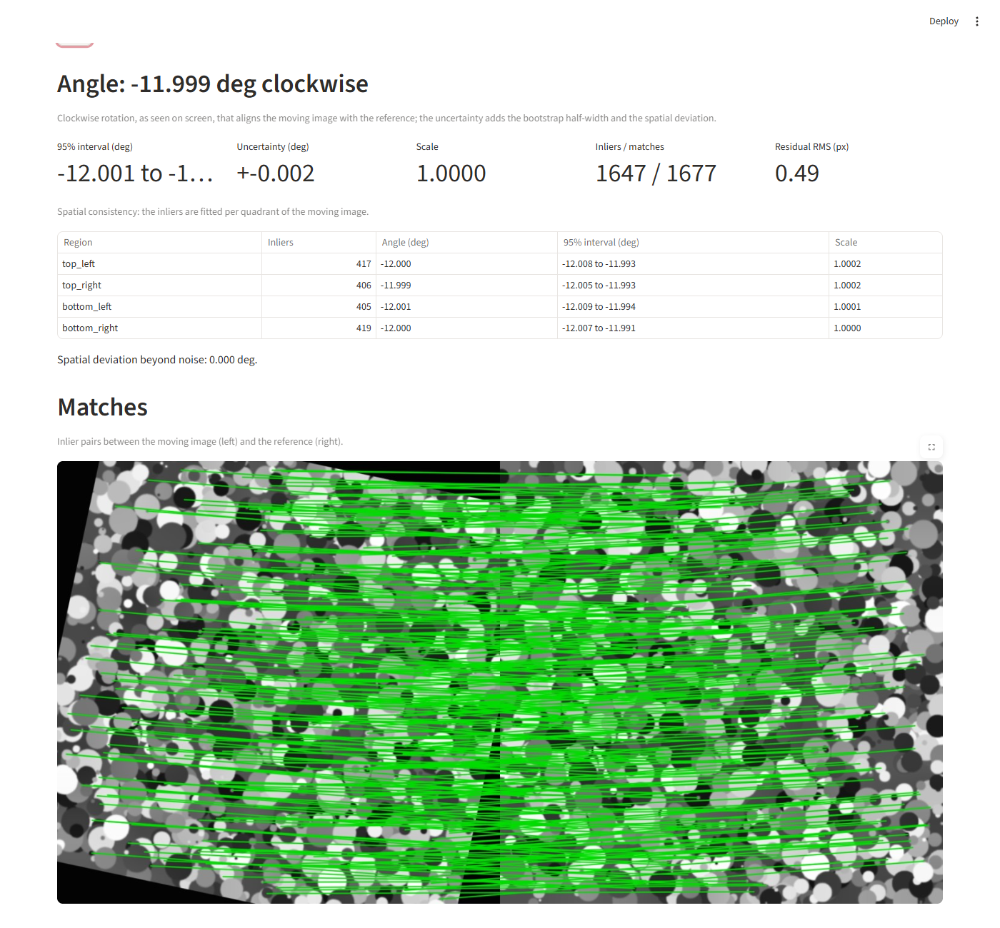

# image-rotation-estimator

Estimate the rotation, scale and translation between two overhead images of the same area — for example,
a top-down render of a 3D model and an orthomosaic — **with a 95 % confidence interval**, and show the evidence.

> **Status:** the CLI and the optional local UI work.

## Why

Aligning two images is a classic, well-solved problem (OpenCV provides the building blocks; libraries such as
`imreg_dft` already estimate rotation with Fourier methods). This project does not claim a new algorithm. Its
focus is **verification**:

- report an uncertainty interval for every estimate;
- produce visual evidence (overlay and checkerboard) that a human can check at a glance.

## MVP scope

| Feature | Method |
|---|---|
| Feature-based registration | SIFT + ratio test + RANSAC (similarity) + least-squares refinement |
| Uncertainty | Bootstrap over inlier matches (95 % interval) |
| Visual evidence | Overlay and checkerboard of the aligned images |
| Quality warnings | Few inliers, high residual, implausible scale |

Possible later work: a Fourier cross-check, a Bayesian estimator, a coverage benchmark and learned matching.

## Usage

```bash
uv sync
uv run rotest compare moving.png reference.png --mask-reference reference_mask.png --out results/
```

Options (see `rotest compare --help`): `--mask-moving`, `--mask-reference` (white = use, black = ignore),
`--work-size` (long side in pixels used for matching, default 4000), `--threads` (OpenCV threads, default half of
the logical cores) and `--out` (default `results`). It writes `results.json`, `overlay.png`, `checkerboard.png`
and `summary.md`. Feature matching uses FLANN with a fixed seed, so repeated runs give the same result.

### Output (`results.json`, schema v2)

Besides the angle, its bootstrap interval `angle_ci95`, scale, translation, inliers and warnings, the file has:

- `angle_uncertainty_deg`: total uncertainty, the bootstrap interval combined with a spatial consistency check;
- `spatial_check`: the angle re-estimated in several image regions and its deviation from the global angle
  (`angle_dev_deg`), which exposes systematic errors that the bootstrap alone cannot see.

**Limitation:** with real data the total uncertainty still underestimates the variation between runs with
different match sets by about 2x. Treat it as a lower
bound when precision better than about 0.1 degrees matters.

## Local UI

An optional Streamlit interface runs the same pipeline from the browser:

```bash
uv sync --extra ui
uv run rotest ui            # --port to change the port (default 8501)
```

Upload the two images (and optional masks), run, and inspect the overlay, checkerboard, matches, residuals,
bootstrap distribution and spatial check. It includes a sign test (the moving image rotated by a known angle) and
downloads for the results. Privacy: the server listens on localhost only, telemetry is disabled and nothing is
uploaded anywhere. Without the `ui` extra, `rotest ui` prints a clear error and the CLI is unaffected.



## Angle convention

`angle_cw_deg` is the clockwise rotation, as displayed on screen, that must be applied to the **moving** image to
align it with the **reference** image. If the reference is north-up, `angle_cw_deg` is the compass heading of the
moving image's "up" direction. The convention is pinned by tests with known synthetic rotations.

## License

MIT. See [`LICENSE`](LICENSE).
